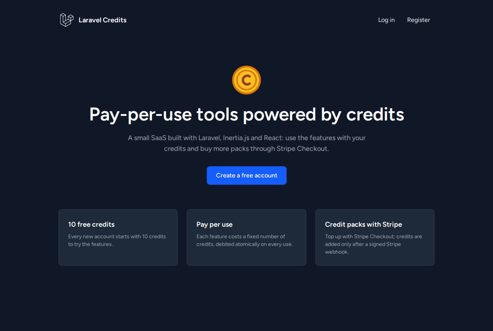
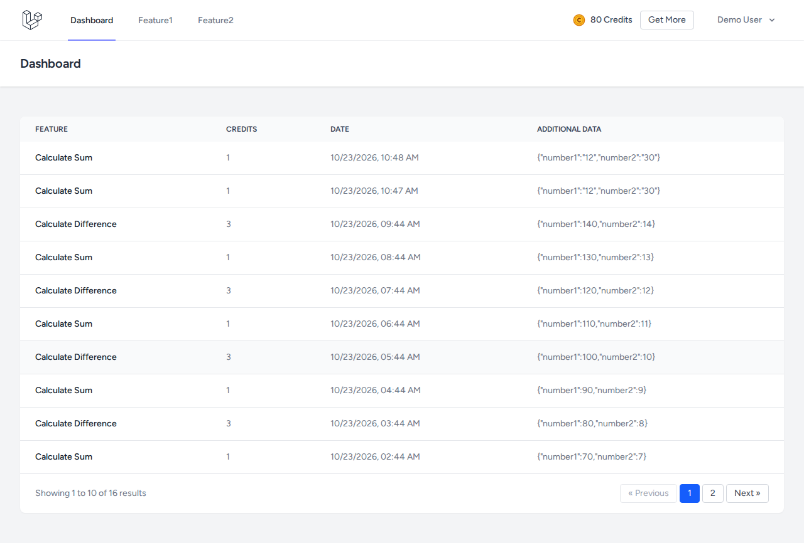
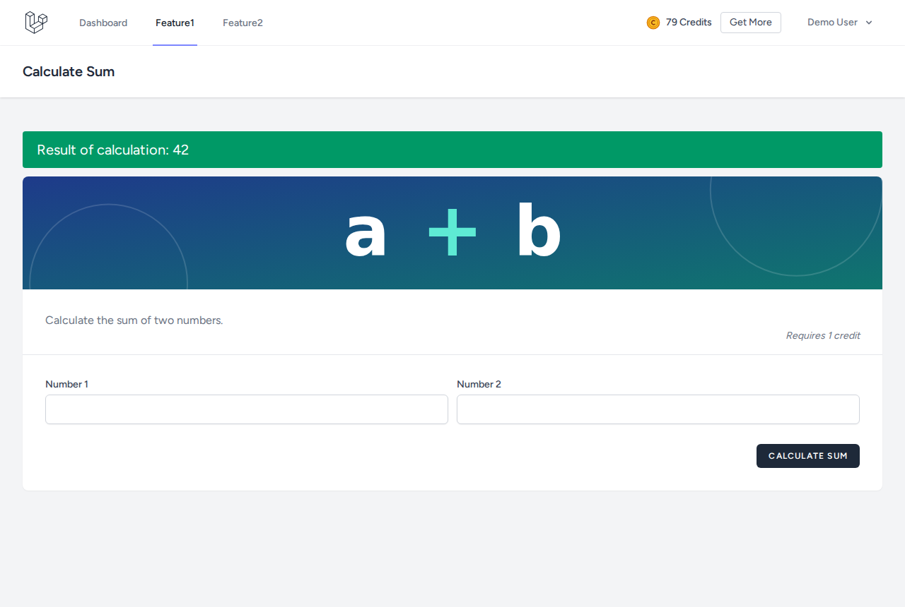
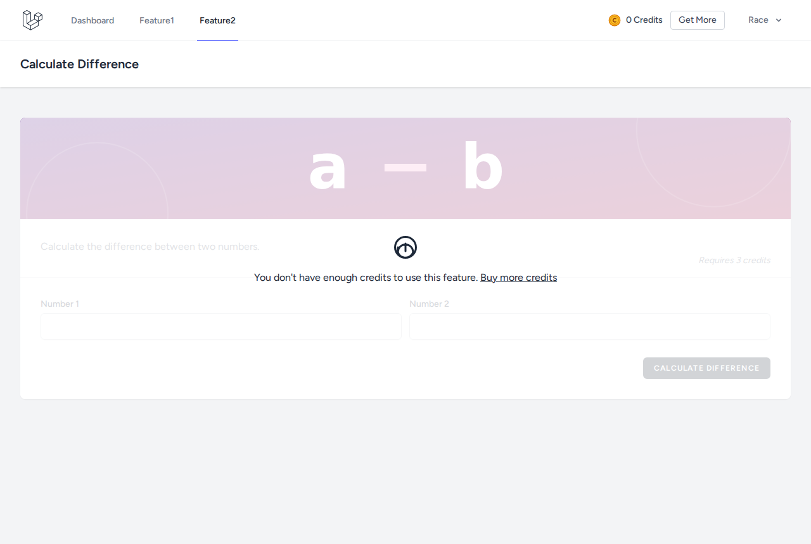

# Laravel Credits : SaaS à crédits avec Laravel 12, Inertia.js, React et Stripe

[](https://github.com/blcoussama/LARAVEL-REACT-STRIPE/actions/workflows/ci.yml)

Petite application SaaS où chaque utilisation d'une fonctionnalité coûte des crédits, rechargeables en achetant des packs via Stripe Checkout.



## Fonctionnalités

- Inscription et connexion (Laravel Breeze, React) : **10 crédits offerts** à la création du compte.
- Deux fonctionnalités payantes : somme de deux nombres (1 crédit) et différence (3 crédits). Chaque utilisation est débitée et enregistrée.
- Si le solde est insuffisant, la fonctionnalité est verrouillée et l'appel est refusé côté serveur.
- Tableau de bord : historique paginé des utilisations (fonctionnalité, crédits, date, données saisies).
- Achat de packs (Basic 20 crédits / 9,99 USD, Silver 100 / 99,99 USD, Golden 500 / 199,99 USD) via **Stripe Checkout**. Les crédits sont ajoutés uniquement à la réception du webhook signé de Stripe.

| Tableau de bord (historique paginé) | Fonctionnalité « somme » |
|---|---|
|  |  |
| **Achat de crédits** | **Crédits insuffisants** |
|  |  |

*Captures réelles de l'application lancée en local (SQLite, données factices du seeder), sans clé Stripe : la page de paiement hébergée par Stripe n'est donc pas montrée. Sans clé, un clic sur « Buy Now » affiche un message d'erreur explicite ([capture](docs/screenshots/stripe-not-configured.png)).*

## Flux de paiement

```
« Buy Now »  ─► POST /buy-credits/{package}
                 ├─ crée une session Stripe Checkout (montant en centimes)
                 ├─ enregistre une transaction « pending » (session_id unique)
                 └─ redirige vers la page de paiement Stripe
Stripe ─► POST /buy-credits/webhook   (checkout.session.completed)
                 ├─ vérifie la signature (en-tête Stripe-Signature + corps brut)
                 └─ dans une transaction SQL : pending → paid, puis crédits ajoutés
                    (une session déjà traitée est ignorée : idempotent)
Stripe ─► GET /buy-credits/success?session_id=…
                 └─ n'ajoute rien : affiche l'état de la transaction de l'utilisateur
```

Sont aussi traités : `checkout.session.async_payment_succeeded` (paiement différé encaissé), `checkout.session.async_payment_failed` (transaction « failed ») et `checkout.session.expired` (transaction « expired »).

## Stack

- **Back-end** : PHP 8.2+, Laravel 12, Eloquent, stripe/stripe-php 17.
- **Front-end** : Inertia.js 2, React 18, Tailwind CSS 4, Vite 6, Ziggy.
- **Base de données** : SQLite par défaut (MySQL ou PostgreSQL possibles via `DB_CONNECTION`).
- **Tests** : Pest 3 (PHPUnit 11).

## Architecture

```
app/
├── Http/Controllers/
│   ├── CreditController.php          # page d'achat, création de la session Checkout, retour succès / annulation
│   ├── StripeWebhookController.php   # vérification de signature et traitement des évènements
│   ├── FeatureController.php         # logique commune des fonctionnalités payantes
│   ├── Feature1Controller.php, Feature2Controller.php
│   └── DashboardController.php       # historique paginé
├── Services/
│   ├── StripeCheckout.php            # construction et création de la session Checkout
│   └── CreditPurchases.php           # crédit idempotent d'un achat confirmé
├── Models/                           # User (spendCredits / addCredits), Package, Transaction, Feature, UsedFeature
└── Observers/UserObserver.php        # 10 crédits à l'inscription
resources/js/Pages/                   # pages Inertia (Dashboard, Feature1, Feature2, Credit, Auth, Profile)
```

## Installation et lancement en local

Prérequis : PHP 8.2+ (extensions `pdo_sqlite`, `mbstring`), Composer 2, Node.js 20+ et npm.

```bash
git clone https://github.com/blcoussama/LARAVEL-REACT-STRIPE.git
cd LARAVEL-REACT-STRIPE

composer install
npm install

cp .env.example .env
php artisan key:generate

touch database/database.sqlite
php artisan migrate --seed

npm run build
php artisan serve          # http://localhost:8000
```

Pour le développement (serveur, file d'attente, logs et Vite en parallèle) : `composer run dev`.

**Compte de démonstration** (données factices) : `demo@example.com` / `password`, avec un achat déjà payé et un historique d'utilisation. Toutes les pages, sauf le paiement lui-même, fonctionnent sans configurer Stripe.

## Configurer Stripe en mode test

1. Créer un compte Stripe et rester en **mode test**. Copier la clé secrète de test (`sk_test_…`) dans `STRIPE_SECRET_KEY`.
2. Installer la [Stripe CLI](https://docs.stripe.com/stripe-cli), puis :
   ```bash
   stripe login
   stripe listen --forward-to localhost:8000/buy-credits/webhook
   ```
   La commande affiche un secret de signature `whsec_…` : le copier dans `STRIPE_WEBHOOK_KEY` et laisser `stripe listen` tourner.
3. `php artisan config:clear` si la configuration était en cache, puis relancer `php artisan serve`.
4. Acheter un pack et payer avec la carte de test `4242 4242 4242 4242` (date d'expiration future, CVC quelconque). Le terminal de `stripe listen` montre l'évènement `checkout.session.completed` et le solde augmente.

`stripe trigger checkout.session.completed` envoie une session qui ne correspond à aucune transaction de l'application : elle est acquittée et ignorée.

## Variables d'environnement

| Variable | Rôle | Valeur locale conseillée |
|---|---|---|
| `APP_NAME`, `VITE_APP_NAME` | Nom affiché | `"Laravel Credits"` |
| `APP_KEY` | Clé de chiffrement | générée par `php artisan key:generate` |
| `APP_ENV`, `APP_DEBUG`, `APP_URL` | Environnement, mode debug, URL de base (utilisée pour les URL de retour Stripe) | `local`, `true`, `http://localhost:8000` |
| `DB_CONNECTION` (+ `DB_HOST`, `DB_PORT`, `DB_DATABASE`, `DB_USERNAME`, `DB_PASSWORD`) | Base de données | `sqlite` |
| `SESSION_DRIVER`, `CACHE_STORE`, `QUEUE_CONNECTION` | Sessions, cache, jobs | `database` |
| `STRIPE_SECRET_KEY` | Clé secrète de l'API Stripe (mode test : `sk_test_…`), jamais envoyée au navigateur | vide tant que le paiement n'est pas testé |
| `STRIPE_WEBHOOK_KEY` | Secret de signature des webhooks (`whsec_…`) | fourni par `stripe listen` |
| `STRIPE_CURRENCY` | Devise des paiements | `usd` |

Les clés sont lues par `config/services.php` (`services.stripe.*`), jamais par `env()` dans le code, ce qui reste compatible avec `php artisan config:cache`.

## Tests

```bash
php artisan test          # ou ./vendor/bin/pest
```

65 tests, sans clé Stripe ni accès réseau (les clés sont forcées à vide dans `phpunit.xml`) :

- `StripeWebhookTest` : la signature est calculée comme le fait Stripe (HMAC-SHA256 avec un secret factice) et vérifiée par le SDK officiel. Couverts : paiement crédité, **même évènement livré deux fois crédité une seule fois**, mauvais secret, corps modifié, en-tête absent (400 et non 500), signature expirée, corps non JSON, secret non configuré, paiement différé, échec, expiration, session inconnue, évènement ignoré.
- `CreditPurchaseTest` : page d'achat, session Checkout simulée (transaction « pending », aucun crédit ajouté), Stripe non configuré ou en erreur, `unit_amount` entier en centimes, page de succès sans effet sur le solde et limitée à l'utilisateur connecté, annulation.
- `FeatureUsageTest`, `CreditBalanceTest` : débit des crédits, **crédits insuffisants**, solde périmé en mémoire (requête concurrente), deux dépenses simultanées du même solde, solde jamais négatif, inscription à 10 crédits même avec un champ `available_credits` forgé, historique paginé et isolé par utilisateur.
- Tests d'authentification et de profil de Breeze.

La CI GitHub Actions (`.github/workflows/ci.yml`) exécute à chaque push : installation, build Vite, migrations et seeder sur SQLite, tests, `composer audit` et `npm audit`.

## Sécurité

- **Webhook** : corps brut et en-tête `Stripe-Signature` vérifiés par `Stripe\Webhook::constructEvent` (tolérance de 5 minutes contre le rejeu) ; route exclue de la protection CSRF uniquement parce qu'elle est authentifiée par signature.
- **Idempotence** : `session_id` unique ; seul l'`UPDATE` qui fait passer la transaction de « pending » à « paid » ajoute les crédits, dans la même transaction SQL.
- **Aucun crédit sans webhook** : la page de succès ne fait qu'afficher l'état de la transaction de l'utilisateur connecté.
- **Débit atomique** : `UPDATE … SET available_credits = available_credits - ? WHERE available_credits >= ?` ; 12 requêtes simultanées sur un compte à 3 crédits ont donné exactement 3 utilisations et un solde de 0 lors d'un essai local.
- **Assignation de masse** : `available_credits` n'est pas dans `$fillable`.
- **Montants** en centimes entiers (pas d'arrondi flottant envoyé à Stripe).
- **Dépendances** : `composer audit` et `npm audit` sans vulnérabilité connue au 23/10/2026.

## Limites connues

- Le parcours complet avec un vrai compte Stripe (mode test) n'a pas été rejoué lors de cette remise à niveau : le webhook est couvert par les tests automatisés et par un envoi local de webhooks signés avec un secret factice.
- Remboursements et litiges (`charge.refunded`, `charge.dispute.*`) non gérés : les crédits achetés ne sont pas retirés.
- Pas de vérification de l'adresse e-mail (`MustVerifyEmail` non activé), une seule devise, pas de facture.
- Les deux fonctionnalités sont des calculs de démonstration.
- Projet non déployé : il est prévu pour être lancé en local.

## Origine du projet

Projet d'apprentissage réalisé en suivant un tutoriel YouTube (SaaS à crédits avec Laravel, React et Stripe).

### Ce que j'ai ajouté / corrigé

- **Paiement terminé** : le webhook ne créditait rien (bloc vide), tombait dans `default` faute de `break` et renvoyait 500 sans en-tête de signature ; il vérifie désormais la signature depuis la requête Laravel, crédite de façon idempotente et met à jour le statut de la transaction.
- Page de succès qui affichait « crédits achetés » sans aucune vérification : elle reflète maintenant l'état réel de la transaction.
- Condition de course sur les crédits (vérification puis décrément séparés) remplacée par un débit atomique.
- `where('active')` corrigé en `where('is_active')` (la page d'achat échouait), `env()` remplacé par `config()`, clés Stripe ajoutées à la configuration, montants stockés en centimes (migration), `available_credits` retiré de `$fillable`.
- Icônes manquantes (`/img/coin.png`, `/img/coing.png`) remplacées par des SVG créés pour le projet, pagination de l'historique affichée, messages d'erreur visibles sur les pages des fonctionnalités, textes blancs sur fond blanc corrigés, page d'accueil du projet à la place de celle de Laravel (qui exposait les versions de Laravel et PHP).
- Seeder de démonstration factice (le compte d'origine était nominatif), tests (65), dépendances mises à jour (`composer audit` : 48 alertes → 0 ; `npm audit` : 0 après migration vers Tailwind CSS 4), CI GitHub Actions et ce README.
